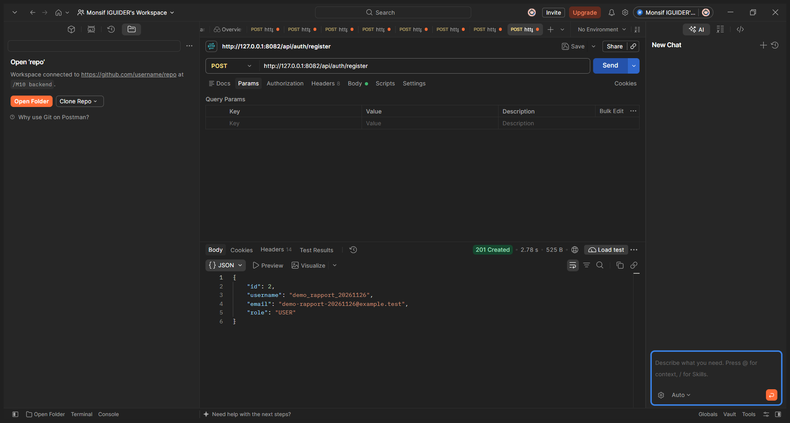
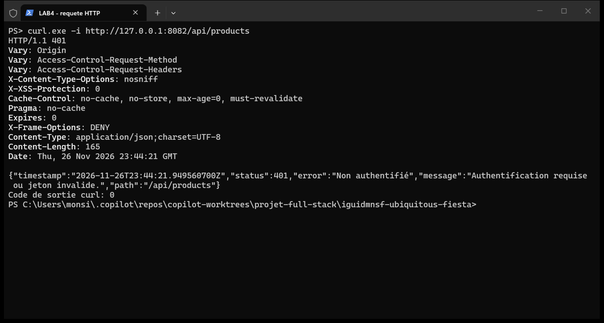
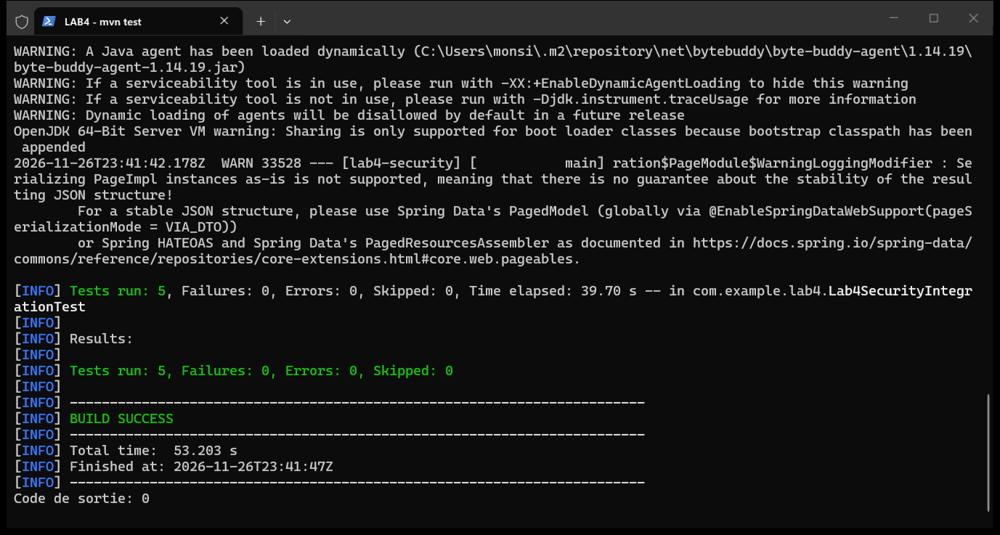

# Rapport de réalisation — LAB4

## Authentification JWT et contrôle des rôles

**Étudiant(e) :** ____________________

**Date de remise :** ____________________
**Projet :** [lab4-spring-security-jwt](https://github.com/IguidMnsf/lab4-spring-security-jwt)

## 1. Objectif

Ce laboratoire ajoute l'authentification et l'autorisation à l'API du LAB3. Il met en pratique Spring Security, les jetons JWT, le hachage des mots de passe et les rôles d'accès.

## 2. Réalisation

L'inscription publique crée toujours un compte `USER`. Le mot de passe est encodé avec BCrypt. Après authentification, l'API remet un JWT signé et limité dans le temps ; un filtre vérifie ce jeton pour les requêtes protégées.

Les rôles déterminent les opérations autorisées : les utilisateurs authentifiés peuvent consulter les produits et les catégories, tandis que leurs modifications sont réservées à `ADMIN`. Les commandes appartiennent au compte qui les a créées ; un utilisateur ne voit que ses commandes, alors que l'administrateur peut les consulter et les supprimer.

La clé JWT et les paramètres du compte administrateur initial sont fournis par des variables d'environnement locales. Ils ne sont pas inclus dans le code livré. Docker Compose configure une base `lab4_db` séparée de celle du LAB3.

## 3. Vérifications

La commande `mvn clean verify` a été exécutée avec Java 21. Les **5 tests d'intégration H2 ont réussi**, sans échec ni erreur. Les tests couvrent notamment l'inscription, le hachage BCrypt, la connexion, les jetons invalides, les réponses `401` et `403`, les rôles et la confidentialité des commandes.

La configuration Docker Compose a été analysée avec `docker compose config`. Une démonstration ultérieure a utilisé une instance MySQL locale distincte de Docker. L'inscription d'un compte `USER` a réussi et une requête sans jeton a été refusée. Les secrets doivent rester masqués dans les captures et ne jamais être publiés.

## 4. Conclusion

Le projet met en œuvre une API stateless protégée par JWT et des autorisations fondées sur les rôles. Le contrôle des commandes tient compte du propriétaire de la ressource et ne repose pas uniquement sur la connaissance de son identifiant.

## 5. Captures des exécutions

**Inscription d'un utilisateur dans Postman — HTTP 201 :**

**Accès aux produits sans jeton — HTTP 401 :**

**Tests automatisés — `mvn test` :**

